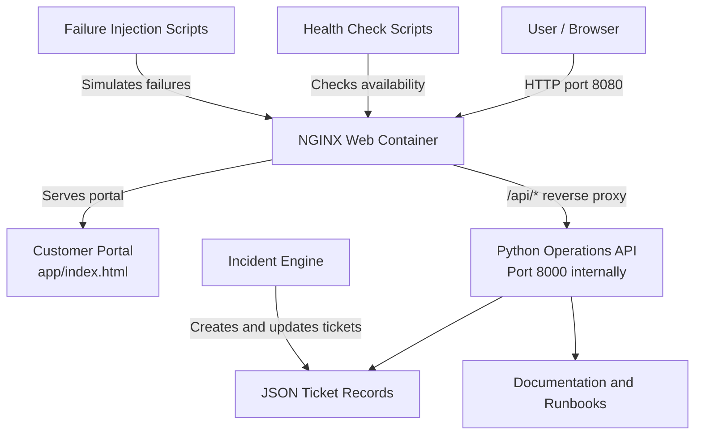

# LSFL Project 3 — System Architecture

This diagram describes the implemented production operations simulation.
Payment processing, inventory services, and a dedicated order-processing
backend are not implemented in this project.

## Implemented Components

- NGINX serves the customer portal and proxies API requests.
- The Python API provides health, ticket, and documentation endpoints.
- Incident records are stored in JSON.
- Shell scripts check portal availability and Docker health.
- The incident engine creates and updates incident tickets.
- Failure-injection scripts simulate service failures for recovery testing.
- Documentation includes incident-response procedures, runbooks, postmortems,
  and failure evidence.

## API Endpoints

- `/api/health` — application health.
- `/api/tickets` — incident and ticket records.
- `/api/docs` — documentation index.

## Scope

This is an operations simulation, not a complete fulfillment platform.
Payment processing, inventory management, and a dedicated order-processing
service are not currently implemented.
